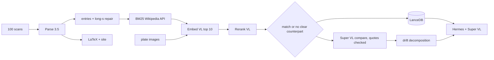

# Knowledge Across Time: Britannica meets Wikipedia

We match 100 scanned pages of the 18th-century Encyclopaedia Britannica to modern Wikipedia articles.
Then we measure what changed: the spelling, the words, the facts, or the coverage.
A Hermes agent on Nemotron 3.5 Super VL answers comparison questions with evidence from both sources.

Every stage uses a Nemotron model. Every answer cites `[B:<row>:<n>]` (Britannica entry) and `[W:<page_id>:<revision_id>]` (Wikipedia revision).

## Try it

- Demo (static archive on Hugging Face Spaces): https://huggingface.co/spaces/nebius-build-week/britannica-across-time
- Dataset (entries, matches, candidates, claims, term pairs, labels, agent runs): https://huggingface.co/datasets/nebius-build-week/britannica-wikipedia-drift
- Republish both: `uv run python scripts/publish_hf.py publish` (see `docs/hf/`)

## Results at a glance

| Stage | Result |
| --- | --- |
| Parse 3.5 | 100 of 100 scans parsed. 2 dense pages needed a two-column fallback. 10 engraving plates. |
| Entries | 262 entries (176 with a headword, 76 continuations), 723 long-s and ligature repairs |
| LaTeX archive | 100 of 100 PDFs compiled, 89 in two columns, reading order and headings kept |
| Matching | Every entry processed. Matched entries and pages are listed in `artifacts/match/`; the rest are marked `no_clear_counterpart` with a reason |
| Retrieval ablation | P@1 on 40 hand-labeled entries: BM25 0.30, + Embed VL 0.56, + Rerank VL 0.70 ([details](docs/retrieval-ablation.md)) |
| Comparison | Pairs compared by Super VL with quote checks. Drift split into enduring, renamed, superseded, dropped claims |
| Agent | Hermes with 4 team tools and 1 skill. 3 success and 3 failure cases ([cases](docs/cases/README.md)) |

Open `site/index.html` for the archive: scan with Parse regions, compiled LaTeX, matches, and drift per page.

## Our contribution

1. **Drift decomposition.** The challenge asks how to tell a change in language from a change in knowledge. For each matched pair we split the difference into four signals, each backed by quotes from both sources:
   - orthographic: long-s and spelling repairs per 100 words (the words changed, the facts did not),
   - lexical: claims that are the same fact under a new name, with old -> new term pairs,
   - knowledge: claims that modern science or history replaced,
   - coverage: claims Wikipedia dropped, and topics only Wikipedia has.
2. **Visual plate matching.** The engraving plates have almost no text. Super VL describes each plate. Embed VL and Rerank VL then compare the plate image itself with Wikipedia candidates. On the Hydrostatics plate BM25 picks the wrong article, and both vision models pick "Hydrostatics".
3. **Retrieval ablation.** We measure what each retrieval step adds, on a labeled set, with examples where the reranker fixes or breaks a match.
4. **Hermes extension that fixed a failure.** A corpus-wide question failed (35 tool calls, no answer, nothing invented). We added the `find_drift` tool. The same question then succeeded with 86% fewer tokens.

## How each Nemotron model is used

| Model | Where | What it does in our pipeline |
| --- | --- | --- |
| `nvidia/nemotron-3.5-parse` (shared endpoint) | `extract.py` | Reads each scan into ordered blocks with class and bbox. Feeds entries, LaTeX structure, and the bbox overlay on the site. Fallback: parse each column when a page loops past the token limit. |
| `nvidia/llama-nemotron-embed-vl-1b-v2` (our GPU) | `match.py`, `index.py`, `plates.py`, agent `search_sources` | Re-scores 30 BM25 candidates per entry (query vs document), embeds plate images as documents, and builds the LanceDB vectors the agent searches. |
| `nvidia/llama-nemotron-rerank-vl-1b-v2` (our GPU) | `match.py`, `plates.py`, agent `search_sources` | Re-ranks the top 10 candidates. Its logit and margin decide match vs `no_clear_counterpart`. For plates it scores the plate image as the document. |
| `nvidia/Nemotron-3.5-Super-VL` (Token Factory) | Hermes agent, `compare.py`, `plates.py` | Agent reasoning and tool calls, reads scans through `view_scan`, describes plates, and writes quote-checked comparisons. Pipeline calls run with thinking off. |
| LanceDB | `data/team.lancedb` | Tables `entries` and `wiki_chunks` (2048-d) for the agent. |
| Hermes Agent v0.22.2 | `integrations/hermes/` | Tools `search_sources`, `get_pair`, `find_drift`, `view_scan` and skill `britannica-compare`. |



## Sample selection

We use the organizer's fixed sample: 100 of 2,573 scans, chosen at random without replacement with seed `20261016`, sorted by source row.
Manifest: `src/nemotron_challenge/resources/britannica-manifest.json`, sha256 `779542e078756874f23fa6971d7d8a2d8635ad6d9d9484e1deb607d94a28e396`.
The selection does not depend on extraction or match quality.

## Data versions

| Source | Version |
| --- | --- |
| Britannica: `NationalLibraryOfScotland/encyclopaedia_britannica_illustrated` | revision `309f765b1ecc83e0a7f7762e44b4a927a7555443`, CC0 |
| Wikipedia: `wikimedia/structured-wikipedia` via the shared BM25 API | revision `417c267bb457fa645c22eb3b5c77764963194c70`, 7,182,883 articles, CC BY-SA 4.0 |
| Embed VL / Rerank VL | revisions `582e3bf7` / `b8a9987b` (pinned in the Docker recipe) |
| Run date | 2026-10-18 |

Each Wikipedia record keeps its page id, revision id, URL, and text sha256. `runs/evaluate.json` records model ids, revisions, and the code revision.

## Setup

Requirements: Python 3.12, [uv](https://docs.astral.sh/uv/), `tectonic` for LaTeX, Hermes Agent, a Nebius Token Factory key, and one GPU for the embed/rerank service.

```sh
uv sync --locked
cp .env.example .env           # set SUPER_API_KEY and RETRIEVAL_BASE_URL
uv run nemotron-challenge data fetch
```

Embed/rerank service. We ran the starter Docker recipe on one Nebius VM (RTX PRO 6000) and reached it through an SSH tunnel:

```sh
# on the GPU VM
docker buildx build --platform linux/amd64 --load -t nemotron-challenge-models:local infra/model-service
docker run -d --name nemotron-models --gpus device=0 --read-only --tmpfs /tmp:rw,nosuid,nodev,size=1g \
  --cap-drop ALL --security-opt no-new-privileges -p 127.0.0.1:8000:8000 nemotron-challenge-models:local
# on the laptop
ssh -N -L 8000:127.0.0.1:8000 <user>@<vm-ip>
uv run nemotron-challenge doctor --live
```

GPU smoke receipt: `runs/model-service-smoke.json`.

## Run the pipeline

```sh
uv run nemotron-challenge run extract    # Parse 3.5 + entries (Parse output is cached)
uv run nemotron-challenge run match      # BM25 -> Embed VL -> Rerank VL -> LanceDB
uv run nemotron-challenge run compare    # word frequency + Super VL pairs + drift
uv run nemotron-challenge run site       # LaTeX PDFs + static site
uv run nemotron-challenge run agent      # Hermes questions -> runs/agent/
uv run nemotron-challenge run evaluate   # case links + run metadata
uv run pytest -q
```

Hermes setup: see [docs/hermes.md](docs/hermes.md) and the install commands in `runs/worker-agent.md`.

## Repository map

| Path | Content |
| --- | --- |
| `src/nemotron_challenge/` | pipeline code: `extract`, `segment`, `match`, `index`, `plates`, `neighbors`, `latex`, `site`, `compare`, `agent_tools`, `evaluate` |
| `integrations/hermes/` | Hermes plugin (4 tools) and skill |
| `artifacts/` | raw Parse output, entries, candidates with all scores, matches, articles, comparisons, plates, LaTeX |
| `site/` | static archive |
| `docs/cases/` | 3 success and 3 failure cases |
| `docs/retrieval-ablation.md` | what BM25, Embed VL, and Rerank VL each add |
| `runs/` | agent transcripts, threshold check, smoke receipt, evaluation record |
| `docs/team-contracts.md` | file formats between stages |

## Limits

- OCR noise is the largest error source. It inflates "superseded" and "renamed" counts. We flag term pairs that look like spelling noise, but not all.
- Rerank logits are low for long noisy queries. Our match rule uses the logit, the margin, and exact titles. The labeled set (40 items) is our own judgment, with one reader.
- The BM25 candidate pool sets the ceiling: if the right article is not in the pool, embed and rerank cannot find it.
- Page 452 is a blank cover. Parse invented fluent text for it, and the error passed through every stage ([failure-3](docs/cases/failure-3.md)).
- The quote check proves that a quote exists in the source, not that it supports the claim.

## Licenses

Code: MIT. Britannica scans: CC0 (National Library of Scotland). Wikipedia text: CC BY-SA 4.0, with revision links in every record. See [ATTRIBUTION.md](ATTRIBUTION.md).
