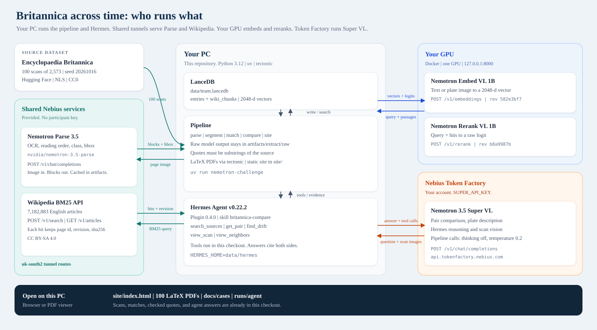
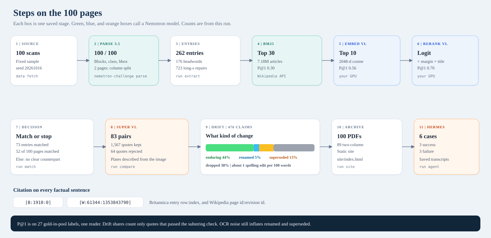
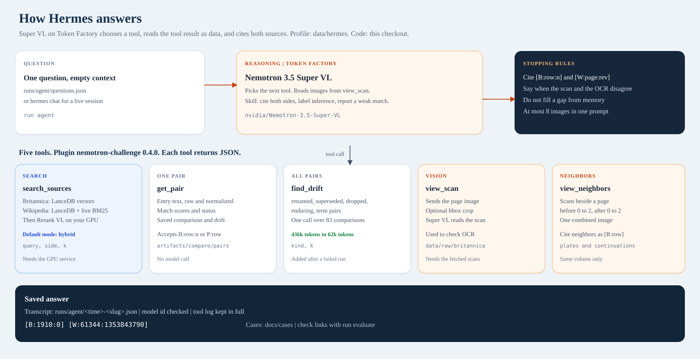

# Knowledge Across Time: Britannica meets Wikipedia

We match 100 scanned pages of the Encyclopaedia Britannica (1768 to 1860) to modern Wikipedia articles, then separate a change in spelling from a change in knowledge.

Public repository: https://github.com/M-Ali-ML/Nebius-Hackathon

- Archive: https://huggingface.co/spaces/nebius-build-week/britannica-across-time
- Dataset: https://huggingface.co/datasets/nebius-build-week/britannica-wikipedia-drift
- Local archive: open `site/index.html` (maps on `site/how.html`)
- APIs, packages, and file layout: [docs/technical.md](docs/technical.md)

## Who runs what



## Steps



## Hermes agent



The saved run is already in this checkout: `site/`, `artifacts/`, `docs/cases/`, and `runs/agent/`. You can read it before you call a model. A full rerun needs the steps below.

## Results

| Stage | Result |
| --- | --- |
| Parse 3.5 | 100 of 100 scans. 2 dense pages used a two-column fallback. 10 engraving plates. |
| Entries | 262 (176 with a headword, 76 continuations). 723 long-s and ligature repairs. |
| LaTeX | 100 of 100 PDFs. 89 two-column. |
| Match | 73 entries matched in either pass. 52 of 100 pages matched. The rest are `no_clear_counterpart` with a reason. |
| Retrieval | P@1 on 27 labeled entries in the BM25 pool: BM25 0.30, plus Embed VL 0.56, plus Rerank VL 0.70. [Details](docs/retrieval-ablation.md) |
| Compare | 83 pairs, 476 quote-checked claims. Enduring 44.1%, dropped 37.8%, superseded 13.2%, renamed 4.8%. |
| Agent | 5 tools. 3 success and 3 failure cases. [Cases](docs/cases/README.md) |

`find_drift` is the tool added after a corpus question failed (35 calls, 435,766 tokens, no invented answer). The same question then used 62,455 tokens.

Every factual sentence cites `[B:<row>:<n>]` and `[W:<page_id>:<revision_id>]`.

## Setup and installation

Run every command from the repository root.

### 1. Install the tools

| Tool | Use | Install |
| --- | --- | --- |
| Python 3.12 | Pipeline. Not 3.14: Hermes may use 3.14, this package does not. | `uv python install 3.12` |
| [uv](https://docs.astral.sh/uv/getting-started/installation/) | Locked dependencies | official installer |
| [tectonic](https://tectonic-typesetting.github.io/) | LaTeX PDFs for `run site` | `brew install tectonic` on macOS |
| [Hermes Agent](https://hermes-agent.nousresearch.com/docs/getting-started/installation/) | Agent only. Tested at v0.22.2. | official installer |
| Docker plus an NVIDIA GPU | Embed VL and Rerank VL | [docs/model-service.md](docs/model-service.md) |
| Nebius Token Factory key | Super VL for compare and the agent | your own account |

Parse 3.5 and the Wikipedia BM25 API are shared event tunnels. They need no key. The URLs are in `.env.example`. If a tunnel is down, the saved files in `artifacts/` still open.

### 2. Python environment

```sh
uv python install 3.12
uv sync --locked
```

### 3. Configuration

```sh
cp .env.example .env
```

| Variable | Required for | Value |
| --- | --- | --- |
| `WIKIPEDIA_API_URL` | match, hybrid search | prefilled shared tunnel |
| `PARSE_BASE_URL` | `parse` | prefilled shared tunnel |
| `PARSE_API_KEY` | only if your Parse host requires it | empty for the event tunnel |
| `RETRIEVAL_BASE_URL` | match, `search_sources` | `http://127.0.0.1:8000/v1` |
| `RETRIEVAL_API_KEY` | only if a proxy requires it | empty for local Docker |
| `SUPER_API_KEY` | compare, plates, Hermes | your Token Factory key |
| `SUPER_BASE_URL` | Super VL | `https://api.tokenfactory.nebius.com/v1` |
| `SUPER_MODEL` | must stay | `nvidia/Nemotron-3.5-Super-VL` |
| `HF_TOKEN` | `scripts/publish_hf.py` only | your Hugging Face token |

Do not commit `.env`.

### 4. Scans

```sh
uv run nemotron-challenge data show
uv run nemotron-challenge data fetch
```

`data show` prints the pinned manifest. `data fetch` downloads the pinned Parquet file (about 357 MiB), checks checksums, and writes 100 images to `data/raw/britannica`. The images are not in git.

### 5. Check the install

```sh
uv run nemotron-challenge doctor --offline
uv run pytest -q
```

`doctor --live` also checks Wikipedia, Parse, the GPU service, and Super VL. It does not run a match. Start the GPU service first if you want that check to pass.

```sh
uv run nemotron-challenge doctor --live
```

### 6. Embedding and reranking service

On the GPU machine, from this repository:

```sh
docker buildx build --platform linux/amd64 --load \
  -t nemotron-challenge-models:local infra/model-service
docker run -d --name nemotron-models --gpus device=0 \
  --read-only --tmpfs /tmp:rw,nosuid,nodev,size=1g \
  --cap-drop ALL --security-opt no-new-privileges \
  -p 127.0.0.1:8000:8000 nemotron-challenge-models:local
```

The image is about 6.8 GB and needs no Hub token. Wait until `curl --fail http://127.0.0.1:8000/ready` returns 200. If the GPU is on another machine, forward the port:

```sh
ssh -N -L 8000:127.0.0.1:8000 <user>@<vm>
```

Set `RETRIEVAL_BASE_URL=http://127.0.0.1:8000/v1`. Full limits, smoke check, and model pins: [docs/model-service.md](docs/model-service.md).

### 7. Hermes

Follow [docs/hermes.md](docs/hermes.md). Short form:

```sh
export HERMES_HOME="$PWD/data/hermes"
export NEMOTRON_REPO="$PWD"
mkdir -p "$HERMES_HOME/plugins" "$HERMES_HOME/skills/research"
cp integrations/hermes/config.example.yaml "$HERMES_HOME/config.yaml"
rm -rf "$HERMES_HOME/plugins/nemotron-challenge"
cp -R integrations/hermes/nemotron-challenge "$HERMES_HOME/plugins/"
cp -R integrations/hermes/skills/britannica-compare "$HERMES_HOME/skills/research/"
hermes plugins doctor integrations/hermes/nemotron-challenge --ci
hermes plugins enable nemotron-challenge
```

### 8. Run the pipeline

Parse output for these 100 pages is already in `artifacts/extract/raw`. `parse` skips a page that has a raw file.

```sh
uv run nemotron-challenge parse
uv run nemotron-challenge run extract
uv run nemotron-challenge run match
uv run nemotron-challenge run compare
uv run nemotron-challenge run site
uv run nemotron-challenge run agent
uv run nemotron-challenge run evaluate
```

| Command | What it spends |
| --- | --- |
| `parse` | Parse 3.5 only for pages missing `artifacts/extract/raw/<row>.json` |
| `run extract` | local segmentation |
| `run match` | Wikipedia API, Embed VL, Rerank VL, then LanceDB |
| `run compare` | Super VL |
| `run site` | tectonic, then `site/` |
| `run agent` | Hermes, Super VL, and the GPU service for `search_sources` |
| `run evaluate` | checks that each case links to a saved transcript |

Plate pages: `uv run nemotron-challenge plates`.

Open the site:

```sh
python -m http.server 8080 -d site
```

Then open http://127.0.0.1:8080/how.html .

Live questions and the three demo prompts: [docs/demo-commands.md](docs/demo-commands.md).

## Sample and versions

The sample is the organizer's fixed draw: 100 of 2,573 scans, seed `20261016`, sorted by source row. Manifest sha256 `779542e078756874f23fa6971d7d8a2d8635ad6d9d9484e1deb607d94a28e396`.

| Source | Version |
| --- | --- |
| Britannica `NationalLibraryOfScotland/encyclopaedia_britannica_illustrated` | `309f765b1ecc83e0a7f7762e44b4a927a7555443`, CC0 |
| Wikipedia via the shared BM25 API | `417c267bb457fa645c22eb3b5c77764963194c70`, 7,182,883 articles, CC BY-SA 4.0 |
| Embed VL / Rerank VL | `582e3bf7` / `b8a9987b` |
| Run date | 2026-10-18 |

`runs/evaluate.json` records model ids, revisions, and the code revision.

## Repository

| Path | Content |
| --- | --- |
| `src/nemotron_challenge/` | Pipeline |
| `integrations/hermes/` | Plugin and skill |
| `artifacts/` | Raw Parse output, entries, scores, matches, comparisons, LaTeX |
| `site/` | Static archive |
| `docs/diagrams/` | The three maps |
| `docs/technical.md` | APIs, packages, commands |
| `docs/cases/` | Six case studies |
| `runs/` | Transcripts, smoke receipt, evaluation record |

## Limits

- OCR noise is the largest error. It inflates superseded and renamed counts. A similarity filter flags some term pairs. It does not flag all of them.
- The 40 retrieval labels are one reader's judgment.
- If the right Wikipedia article is outside the 30 BM25 hits, embed and rerank cannot find it.
- Page 452 is a blank cover. Parse invented text for it, and that text passed through later stages. [failure-3](docs/cases/failure-3.md)
- A quote check shows that the quote is in the source. It does not show that the quote supports the claim.
- The plate prompt names a date range. The collection covers 1768 to 1860, and a page row has no edition date.

## Licenses

Code: MIT. Britannica scans: CC0 (National Library of Scotland). Wikipedia text: CC BY-SA 4.0, with revision links on each record. [ATTRIBUTION.md](ATTRIBUTION.md).
