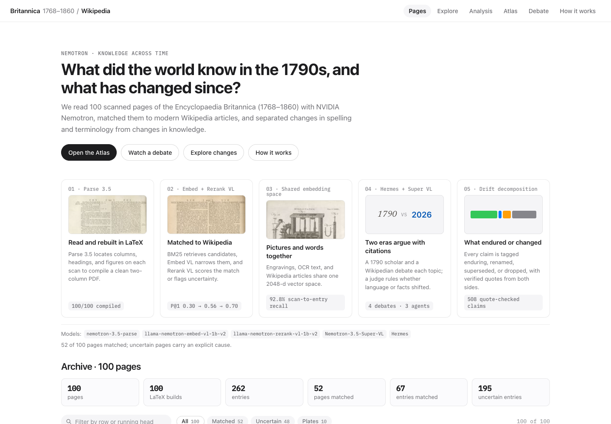
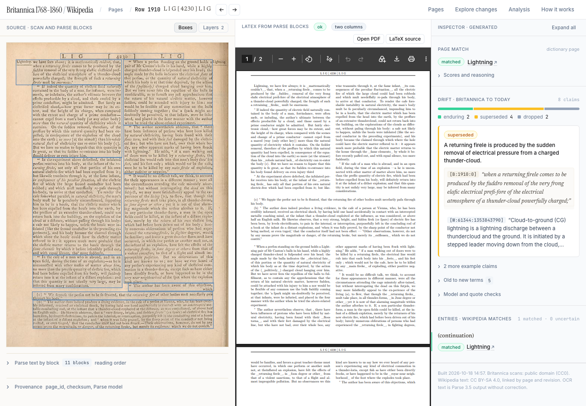
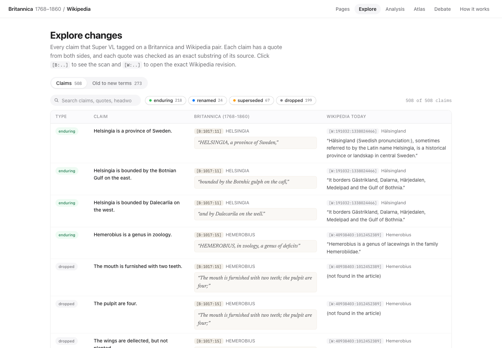
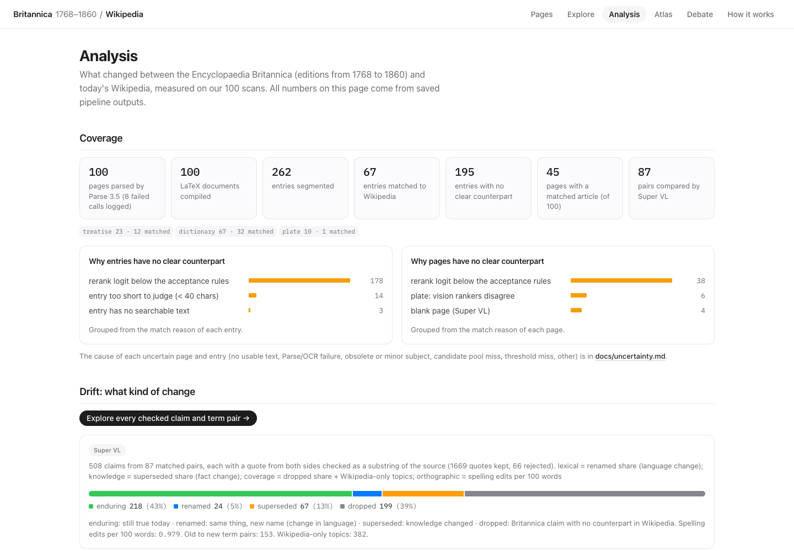
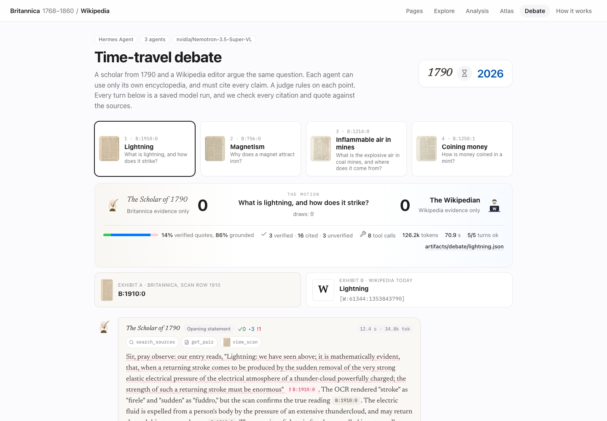

# Knowledge Across Time: Britannica meets Wikipedia

We match 100 scanned pages of the Encyclopaedia Britannica (1768 to 1860) to modern Wikipedia articles, then separate a change in spelling from a change in knowledge.

**Winner of the NVIDIA track** at the Nebius Build Week hackathon, for the best use of an NVIDIA Nemotron model.

## Open it on Hugging Face

The archive is a Hugging Face Space. Open it here:

**https://huggingface.co/spaces/nebius-build-week/britannica-across-time**

The dataset of entries, matches, claims, and agent transcripts is [nebius-build-week/britannica-wikipedia-drift](https://huggingface.co/datasets/nebius-build-week/britannica-wikipedia-drift).

The pictures below are the live Space. Each one links to that screen.

### The archive

### One page: the scan, the LaTeX rebuild, and the Wikipedia match

### Every claim, with a quote from both sides

### What changed, and why some pages have no match

### The agent debate

Three Hermes agents on Nemotron 3.5 Super VL argue one question. The Scholar of 1790 cites only Britannica. The Wikipedian cites only Wikipedia. The Judge rules each point.

The same Space also has the [atlas](https://nebius-build-week-britannica-across-time.static.hf.space/atlas.html).

## The parts

| Part | Where |
| --- | --- |
| Results | [docs/results.md](docs/results.md) |
| How to run it | [docs/setup.md](docs/setup.md) |
| Atlas | [docs/atlas.md](docs/atlas.md) |
| Agent debate | [docs/debate.md](docs/debate.md) |
| Six case studies | [docs/cases/README.md](docs/cases/README.md) |
| All of the docs | [docs/README.md](docs/README.md) |

Source: https://github.com/M-Ali-ML/Nebius-Hackathon

Code: MIT. Britannica scans: CC0 (National Library of Scotland). Wikipedia text: CC BY-SA 4.0. [ATTRIBUTION.md](ATTRIBUTION.md).
