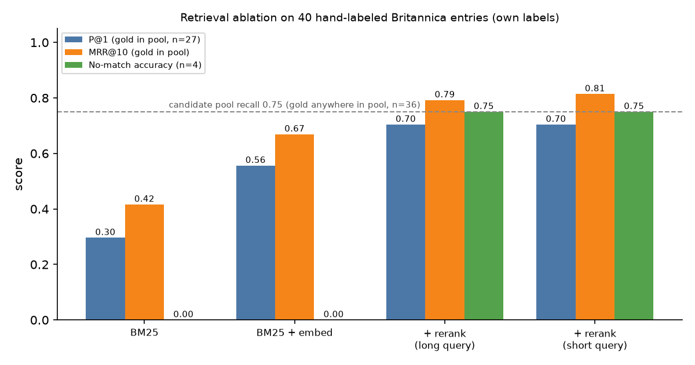

# Retrieval ablation: BM25, embedder, reranker

This page shows what each retrieval step adds when we match Britannica entries (1771 to 1797 scans) to Wikipedia articles.
All numbers come from saved candidates. The evaluation makes no new model calls.

## Method

For each entry the match stage keeps every score (`artifacts/match/candidates/<entry_id>.json`):

1. BM25: the shared Wikipedia index returns 30 hits for "headword + distinctive terms", plus 5 hits for the headword alone.
2. Embed: `nvidia/llama-nemotron-embed-vl-1b-v2` embeds the entry (query) and each hit (title + 1,000-char excerpt, document). We keep the top 10 by cosine.
3. Rerank: `nvidia/llama-nemotron-rerank-vl-1b-v2` scores the 10 with the entry text as the query.
   - Long query: headword + entry text, cut to 2,000 chars.
   - Short query: headword (or the cleaned page topic) + the first 600 chars (`artifacts/match/candidates_short/`).

We compare the top-1 of four rankings: BM25, BM25 + embed, + rerank (long query), + rerank (short query).

## Labeled set

`artifacts/match/labels.jsonl` has 40 entries.
One reader (the match worker, Claude Opus 5.5) labeled them by reading the entry text against the candidate excerpts.
This is our own judgment, not a gold standard. There is no second annotator.

- 15 items come from the threshold check in `runs/match-threshold-check.md`. 25 items are a random sample (seed 7) of entries with 40 or more chars.
- 36 items have a real Wikipedia counterpart. 4 items have no clear counterpart (for example, page 452, where Parse produced invented text).
- For 27 of the 36, the right article is somewhere in the saved candidate pool. For 9, it is not (for example, Nazareth, Islay, Laurus, John Hughes (poet)).
- Some labels accept the closest article in the pool when the ideal one is absent (for example, Polydipsia for THIRST). The note on each item says so.

## Results



Source: `artifacts/match/ablation_summary.json`. Chart copy: `artifacts/match/ablation.png`.

| Method | P@1 (gold in pool, n=27) | P@1 (all 36 positives) | MRR@10 (gold in pool) | Recall@10 (all positives) | No-match accuracy (n=4) |
| --- | --- | --- | --- | --- | --- |
| BM25 | 0.30 | 0.22 | 0.42 | 0.53 | 0.00 (no reject step) |
| BM25 + embed | 0.56 | 0.42 | 0.67 | 0.69 | 0.00 (no reject step) |
| + rerank, long query | 0.70 | 0.53 | 0.79 | 0.69 | 0.75 |
| + rerank, short query | 0.70 | 0.53 | 0.81 | 0.72 | 0.75 |

Candidate pool recall: 27 of 36 (0.75). The reranker cannot fix the other 9 because BM25 never returned the right article.

What the numbers say:

- The embedder almost doubles BM25 top-1 accuracy (0.30 to 0.56). BM25 favors short pages with the same rare words. The embedder favors the page about the same subject.
- The reranker adds another 14 points (0.56 to 0.70). It reads the entry and the excerpt together, so it separates close neighbors such as "Damsel" and "Damsel in distress".
- Recall@10 is the same for embed and long rerank, because the reranker only reorders the embedder's top 10. The short-query pass also adds page-topic hits for continuation entries, so its recall is a little higher.
- Short and long queries give the same P@1. The short query ranks slightly better overall (MRR 0.81 vs 0.79).
- With our accept rules (see `runs/match-threshold-check.md`), the long-query pass accepts 13 of the 40 labeled items. 12 of these are correct. Inference: the rules are strict. They keep false matches low and leave many correct top-1 results unaccepted.
- The weakest step is candidate recall. Main articles for broad topics (Nazareth, Edward III of England) and OCR-garbled headwords (OUNDELE, ENTILADE) never reach the pool.

## Examples

Citation IDs: `[B:<row>:<n>]` for entries and `[W:<page_id>:<revision_id>]` for articles.

Rerank fixed the ranking:

1. LIGHTNING continuation [B:1910:0].
   - BM25 top-1: Ball lightning [W:194422:1353853517].
   - Embed top-1: Thunder house [W:52093675:1186402443].
   - Rerank top-1: Lightning [W:61344:1353843790] (correct).
2. DAMSEL [B:1214:1], a title for young nobles.
   - BM25 top-1: Damsel of Cyprus [W:63642434:1347192054].
   - Embed top-1: Damsel in distress [W:301517:1352628223].
   - Rerank top-1: Damsel [W:51545665:1322363950] (correct).
3. CARPENTRY treatise page, beams and forces [B:1680:0].
   - BM25 top-1: Roberval balance [W:2930612:1148459551].
   - Embed top-1: Truss [W:397263:1352695137]; Carpentry was rank 6.
   - Rerank top-1: Carpentry [W:189274:1352816782] (correct).

Rerank broke the ranking:

4. THIRST [B:1614:1].
   - Embed top-1: Polydipsia [W:600451:1350755259] (correct).
   - Rerank top-1: Thirsty (disambiguation) [W:17985120:1260172013]; Polydipsia dropped to rank 2.
   - The decision step drops disambiguation pages, so the final match is still Polydipsia. The raw rerank top-1 is wrong.

A loss from the embed filter: ENGRAVING continuation [B:1803:0].
BM25 ranked Line engraving [W:4148783:1326288842] first.
The embedder did not keep it in its top 10, so the reranker never saw it and chose Etching revival [W:3083357:1347822839].

## Vision query expansion

Some pages have no accepted match after the text passes, mostly because BM25 never returns the right article.
For these pages we ask Super VL (`nvidia/Nemotron-3.5-Super-VL`, thinking off) to read the scan.

1. Input: the scan as a JPEG (longest side 1,600 px) and the Parse running head.
2. Super VL returns JSON: the page subject and 3 to 5 Wikipedia search phrases. It does not write or fix source text, and it does not decide the match.
3. BM25 runs on each phrase (top 10). One more BM25 query joins the subject, the phrases, and 20 distinctive page terms, because bare titles rank short pages first.
4. The new hits join the page's earlier candidates. Embed VL ranks them against a short page query (subject + 600 chars of page text). Rerank VL scores the top 16.
5. The same accept rules decide (logit > -4.0, or margin, or exact title against the Super VL subject).

Records: `artifacts/match/vision_expand/<row>.json` (Super VL reply, searches, all hits, scores), method `vision_expand`.
Summary: `artifacts/match/vision_summary.json`. The page table before this step is `artifacts/match/page_matches_v1.jsonl`.

Results:

- 46 non-plate pages had no match. Super VL answered for 45. Plate pages were already handled by the site worker's visual matching.
- Page 546 failed: Super VL says the scan is a blank page. Parse had returned modern-sounding text for it. Inference: that text was invented by Parse, and the page has no counterpart.
- 7 pages were accepted: Farm (217), Jonathan Swift (257), Political economy (383), Conchology (473), Arabs (914), Hedge (1324), Arsenic (1722).
- Page coverage: 45 of 100 before, 52 of 100 after.
- Cost: 45 Super VL calls, 28,321 prompt tokens and 1,808 completion tokens, 1.4 s per call on average.

Effect on the labeled set (6 labeled entries with a counterpart sit on expanded pages):

| | Before | After |
| --- | --- | --- |
| Gold article anywhere in the pool | 4 of 6 | 6 of 6 |
| Gold article in the top 10 after rerank | 3 of 6 | 5 of 6 |
| Gold article at top 1 | | 2 of 6 |

Laurus [B:268:0] and Islay [B:493:0] entered the pool only through Super VL phrases.
Laurus is now the top-1 for its page. It was not accepted because the margin is flat (-7.32, margin 0.11).

Still rejected, with the right article now at top 1: Shipbuilding (13), Mount Etna (247), Laurus (268).
These fail the accept rules on logit or margin. They stay `no_clear_counterpart`, with the reason in `page_matches.jsonl`.
Inference: candidate recall improved more than the decision rules can show. A softer rule (for example, agreement between the Super VL subject and the rerank top-1) could accept them, but we have not tested it on labels.

## Limits

- 40 items, one reader. One item changes P@1 by about 4 points.
- The 4 no-match items are too few to measure rejection well.
- These checks measure ranking, not OCR quality. Parse errors upstream (page 452) make some entries unmatchable.

## Rerun

```sh
uv run python -c "from pathlib import Path; from nemotron_challenge.ablation_eval import evaluate; evaluate(Path('/Users/aly/repos/Nebius-Hackathon/artifacts'))"
```

To change labels, edit `artifacts/match/labels.jsonl` (keep `gold_titles`, `gold_page_ids`, and `note`) and rerun.
